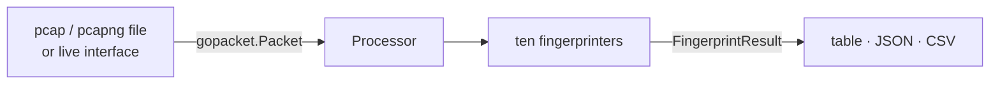

<p align="center">
  
</p>

<h1 align="center">ja4plus-go</h1>

<p align="center"><b>JA4+ network fingerprinting for Go</b>, as a library and as one static binary.</p>

<div align="center">

[](https://github.com/Crank-Git/ja4plus-go/actions/workflows/ci.yml)
[](https://github.com/Crank-Git/ja4plus-go/releases)
[](go.mod)
[](https://pkg.go.dev/github.com/Crank-Git/ja4plus-go)
[](LICENSE)

</div>

<p align="center">
  <a href="https://crank-git.github.io/ja4plus-go/"><b>Docs</b></a> ·
  <a href="#install"><b>Install</b></a> ·
  <a href="#quick-start"><b>Quick start</b></a> ·
  <a href="https://github.com/Crank-Git/ja4plus-go/releases"><b>Releases</b></a>
</p>



## Why ja4plus-go

I wrote [ja4plus](https://github.com/Crank-Git/ja4plus) in Python first. This is the Go
implementation of the same JA4+ methods, so you can fingerprint traffic from inside a Go
program or with one binary that has no runtime to install. Both projects test against the
same FoxIO vectors, which is what keeps their answers in agreement.

The FoxIO reference decides every value. `make conformance` runs this library against
FoxIO's own captures and vectors at commit
[`16b96d95`](https://github.com/FoxIO-LLC/ja4/tree/16b96d95c220762cf658f67d678cda2aac95c81e)
(`testdata/foxio.pin`), and every accepted difference has an entry in
`testdata/deviations.json` that names the issue that ruled it. Each run rewrites the
figures in [`docs/audit/conformance.md`](docs/audit/conformance.md).

Beyond TLS over TCP, the library decrypts a QUIC Initial packet (RFC 9001 and RFC 9369)
to read the ClientHello inside it. Give it a key log and it decrypts TLS 1.3 records on
TCP too, so JA4X reads the Certificate and JA4H reads HTTP/2 requests. It doesn't read HTTP/3: the QPACK header block travels in protected QUIC
packets that the library doesn't decode.

## Methods

| Method | Reads | Fingerprint of |
|---|---|---|
| JA4 | TLS, QUIC | The client's ClientHello |
| JA4S | TLS, QUIC | The server's ServerHello |
| JA4H | HTTP | A client's request headers and cookies |
| JA4T | TCP | A client's SYN |
| JA4TS | TCP | A server's SYN-ACK |
| JA4L | TCP, QUIC | Client-side latency and distance |
| JA4LS | TCP, QUIC | Server-side latency and distance |
| JA4X | X.509 | How a certificate was built, from its OID sequences |
| JA4SSH | SSH | The session type, from traffic patterns |
| JA4D | DHCPv4 | One DHCPv4 packet |
| JA4D6 | DHCPv6 | One DHCPv6 packet |
| JA4TScan | TCP | The SYN-ACK that answers one SYN you send (package `scan`) |

Ten fingerprinters carry the eleven passive methods, because `JA4LFingerprinter` writes
both JA4L and JA4LS. The opt-in `scan` package carries JA4TScan, the one active method.
FoxIO's own list also has twelve entries, but a different twelve: `License FAQ.md:5` at
FoxIO commit `16b96d95` lists JA4Scan and leaves out JA4. Each value's format is on its
[method page](https://crank-git.github.io/ja4plus-go/methods/).

## Requirements

- **Go 1.26 or later** to build against the library. `go.mod` declares `go 1.26.0`.
- **go1.26.11 or later** to build a binary you ship: the oldest Go 1.26 toolchain the
  project has measured clean with `govulncheck`. The dated runs are in the
  [implementation notes](https://crank-git.github.io/ja4plus-go/implementation-notes/).
- **No cgo** for anything except one build tag. `-tags libpcap` adds a cgo path through
  libpcap, and you only need it for `ja4plus watch --bpf`, or for `watch` on macOS. Linux
  captures in pure Go, and `watch` doesn't run on Windows.
- **Capture privilege** for `watch` and `scan`: `CAP_NET_RAW` on Linux, or access to the
  `/dev/bpf*` devices on macOS.

## Install

```bash
go get github.com/Crank-Git/ja4plus-go@latest                   # the library
go install github.com/Crank-Git/ja4plus-go/cmd/ja4plus@latest   # the CLI
```

Or grab a prebuilt CLI from [GitHub Releases](https://github.com/Crank-Git/ja4plus-go/releases):
one binary each for Linux and macOS on amd64 and arm64, and Windows on amd64, plus a
`checksums.txt`. On Linux:

```bash
curl -LO https://github.com/Crank-Git/ja4plus-go/releases/latest/download/ja4plus-linux-amd64
sudo install -m 0755 ja4plus-linux-amd64 /usr/local/bin/ja4plus
```

Release binaries are built with `CGO_ENABLED=0`. For the libpcap path, build from a clone
with `go build -tags libpcap ./cmd/ja4plus`.

## Quick start

### One run, and the output it writes

`make corpus` fetches the FoxIO corpus, and this capture comes from it. From the
repository root:

```bash
ja4plus analyze testdata/foxio/pcap/tls12.pcap
```

```text
Type  Source                 Destination         Fingerprint
ja4   192.168.133.129:36372  34.117.237.239:443  t13d1715h2_5b57614c22b0_3d5424432f57
```

A test runs that command against the corpus and fails if the output drifts from this block.

### From Go

This reads a capture file and prints every fingerprint the `Processor` produces:

```go
package main

import (
    "fmt"
    "os"

    ja4plus "github.com/Crank-Git/ja4plus-go"
    "github.com/gopacket/gopacket"
    "github.com/gopacket/gopacket/pcapgo"
)

func main() {
    f, _ := os.Open("capture.pcap")
    defer f.Close()

    reader, _ := pcapgo.NewReader(f)
    proc := ja4plus.NewProcessor()

    for {
        data, ci, err := reader.ReadPacketData()
        if err != nil {
            break
        }
        pkt := gopacket.NewPacket(data, reader.LinkType(), gopacket.Default)
        pkt.Metadata().Timestamp = ci.Timestamp

        results, _ := proc.ProcessPacket(pkt)
        for _, r := range results {
            fmt.Printf("[%s] %s:%d -> %s:%d  %s\n",
                r.Type, r.SrcIP, r.SrcPort, r.DstIP, r.DstPort, r.Fingerprint)
        }
    }
}
```

`ProcessPacket` returns the results and a slice of non-fatal errors, one per fingerprinter
that couldn't read the packet. A malformed packet never stops the run.

## Usage

```bash
ja4plus analyze capture.pcapng --types ja4,ja4s --json
ja4plus watch --interface eth0 --csv --stats-interval 10
ja4plus cert server.pem
ja4plus db update
sudo ja4plus scan 203.0.113.0/28 --port 443 --format json
```

`analyze` reads pcap and pcapng, and picks the format from the file's magic number rather
than its extension. `watch` takes the same output and lookup options on a live interface,
and writes one JSON object per line instead of one array. `cert` reads a DER or PEM
certificate. `db update` pulls the latest `ja4plus-mapping.csv` from FoxIO into a local
cache, and `db info` tells you which table a run reads. `--lookup` names the application
from that table, and `--lookup-remote` also sends each fingerprint the table doesn't hold
to `ja4db.com`.

`scan` is the one subcommand that sends packets. It sends one SYN to each IPv4 target and
writes a JA4TScan for each target that answers. It doesn't touch your firewall: it prints
the rules it needs to standard error before the first SYN, and you add them. Every option
is on the [usage page](https://crank-git.github.io/ja4plus-go/usage/).

## API

`v1.0.0` froze the exported API for the whole `v1` series: `docs/api/v1.md` records every
name and signature, and a test fails when the code drifts from it. The index is on
[pkg.go.dev](https://pkg.go.dev/github.com/Crank-Git/ja4plus-go) and in the
[API reference](https://crank-git.github.io/ja4plus-go/reference/).

Each method also has its own fingerprinter (`NewJA4`, `NewJA4S`, …, `NewJA4SSH(0)` for the
default 200-packet window). JA4SSH holds its last window open until 200 packets arrive, so
call `CloseOpenWindows` when your input ends or you lose that window.

### One-Shot Functions

Each one-shot function below computes one fingerprint, and it holds no connection state:

```go
fp := ja4plus.ComputeJA4(packet)
fp := ja4plus.ComputeJA4S(packet)
fp := ja4plus.ComputeJA4H(packet)
fp := ja4plus.ComputeJA4T(packet)
fp := ja4plus.ComputeJA4TS(packet)
fp := ja4plus.ComputeJA4D(packet)
fp := ja4plus.ComputeJA4D6(packet)
fp := ja4plus.ComputeJA4XFromDER(certBytes)
fp := ja4plus.ComputeJA4XFromPEM(pemBytes)
fp := ja4plus.ComputeJA4XFromPacket(packet)
```

JA4L, JA4LS, and JA4SSH measure a run of packets, so none of them has one. Use `NewJA4L`
(it serves both JA4L and JA4LS) or `NewJA4SSH`.

### Fingerprint lookup

`LookupFingerprint` returns the application that the embedded FoxIO mapping (or your
cached copy) holds for a fingerprint, and the `ja4plus` package never touches the network.
The one function that does, `LookupFingerprintRemote`, lives in
`github.com/Crank-Git/ja4plus-go/ja4db`, so you link an HTTP client only if you import it.

### Concurrency

One `Processor` serves one goroutine, and so does each fingerprinter: no lock guards their
state, and sharing one is a data race the library won't detect for you. To fan out, route
packets with `GetShardKey` so both directions of a connection land on the same
`Processor`, or share one `SyncProcessor`, which serializes every call with a mutex. Both
patterns are on the [concurrency page](https://crank-git.github.io/ja4plus-go/concurrency/)
as programs that compile and run.

## Documentation

| Page | What's there |
|---|---|
| [Usage](https://crank-git.github.io/ja4plus-go/usage/) | Every subcommand and option, and the library walkthrough. |
| [Output schema](https://crank-git.github.io/ja4plus-go/output-schema/) | Every field in table, JSON, and CSV output. |
| [Live capture](https://crank-git.github.io/ja4plus-go/live-capture/) | `watch`, its platforms, and the `libpcap` build tag. |
| [Concurrency](https://crank-git.github.io/ja4plus-go/concurrency/) | The sharded and shared patterns, and the state bounds. |
| [Methods](https://crank-git.github.io/ja4plus-go/methods/) | One page per method: the format, the parts, and the FoxIO evidence. |
| [API reference](https://crank-git.github.io/ja4plus-go/reference/) | Fingerprinters, processors, types, and the `ja4db` remote lookup. |
| [Implementation notes](https://crank-git.github.io/ja4plus-go/implementation-notes/) | Toolchain measurements, cgo, the state bounds, and conformance. |
| [Parity with the port](https://crank-git.github.io/ja4plus-go/parity/) | How each name in the Python port maps onto this library. |
| [License](https://crank-git.github.io/ja4plus-go/licensing/) | Which license covers which method. |

## Development

```bash
git clone https://github.com/Crank-Git/ja4plus-go.git
cd ja4plus-go
go test -race ./...
```

`make corpus` fetches the FoxIO corpus, and `make conformance` runs the suite against it.
`make lint` runs the pinned `golangci-lint`, and `make docs` builds the site with
`mkdocs build --strict`.

## Security

Report a vulnerability privately at
<https://github.com/Crank-Git/ja4plus-go/security/advisories/new>, not in a public issue.

Every packet this library reads is untrusted input, so a bounds bug in a parser is
reachable from the network. A crash, a hang, an out-of-range read, or a value that breaks
its documented format is worth a report.

## Acknowledgments

John Althouse created JA4+ at [FoxIO](https://foxio.io). The original specification and
reference implementations are at [github.com/FoxIO-LLC/ja4](https://github.com/FoxIO-LLC/ja4),
and this library is an independent implementation of them.

## License

The BSD 3-Clause license in [LICENSE](LICENSE) covers the original Go code, and FoxIO licenses the JA4 method under [LICENSE-JA4](https://github.com/FoxIO-LLC/ja4/blob/main/LICENSE-JA4).
[FoxIO License 1.1](https://github.com/FoxIO-LLC/ja4/blob/main/LICENSE) covers JA4S, JA4H, JA4T, JA4TS, JA4TScan, JA4L, JA4LS, JA4X, JA4SSH, JA4D and JA4D6, and it permits non-commercial use only.
A commercial user contacts [FoxIO](https://foxio.io) for those methods, and [NOTICE](NOTICE) holds the FoxIO terms.

---

<sub>Also in Python: <a href="https://github.com/Crank-Git/ja4plus">ja4plus</a> · Built by <a href="https://github.com/Crank-Git">Crank</a> · <a href="https://github.com/Crank-Git">More projects</a></sub>
